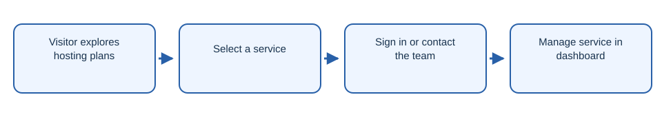

# Drago FR

Hosting service website with pricing, account pages, and contact forms.

## Workflow

1. Visitor explores hosting plans.
2. Select a service.
3. Sign in or contact the team.
4. Manage service in dashboard.

## Getting started

Run `npm install` from the repository root, then `npm run dev --prefix apps/web` for the web app. Authentication needs a separately configured PocketBase service at `/hcgi/platform`.

## License

The project code is licensed under AGPL-3.0-only. See [LICENSE](LICENSE).
